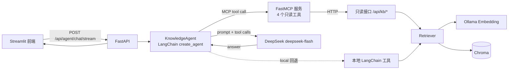

# Agent 知识库问答系统（Agent + RAG）

一个以 **Agent 为主、RAG 为辅**的本地知识库问答系统：Agent 用 LangChain `create_agent` 构建，自行判断是否需要检索；RAG 只是它的一个工具。项目同时保留纯 RAG 流水线作为 baseline，方便对比两种方案的效果和延迟。

## 功能

- **Agent 自主决策**：直接回答 / 调用知识库检索 / 列出文档 / 多次检索后再回答
- **FastMCP 服务**：把知识库能力暴露为 4 个只读 MCP 工具，支持 stdio 和 Streamable HTTP
- **MCP 工具调用**：Agent 通过 `langchain-mcp-adapters` 加载 MCP 工具，`AGENT_TOOL_SOURCE=local|mcp|auto` 可切换并支持失败回退
- LangChain `create_agent` + DeepSeek `deepseek-flash`（关闭 thinking，工具调用更稳定）
- RAG 工具复用 Chroma + Ollama `qwen3-embedding:0.6b`，不重复实现检索
- 多轮对话：Streamlit 保存历史并随请求发送，后端无状态
- Streamlit 聊天界面：工具调用状态、引用来源、工具来源（MCP/本地）、文档上传/删除
- 保留纯 RAG baseline：`/api/chat`、`RagChain`、旧静态页
- 支持 Markdown / TXT / PDF 文档入库
- 向量检索 + 距离阈值 + 可选 BM25 混合检索（RRF 融合，`HYBRID_ENABLED` 开关）
- 回答带 `[1][2]` 引用，API 返回来源、页码、片段和距离
- 评测脚本：Hit@k、MRR、块级关键词覆盖率、拒答准确率、平均延迟、可选 LLM-as-Judge
- 工具调用评测：工具集合准确率、`source` 参数准确率、无工具题准确率、MCP/本地来源统计
- pytest 覆盖切分、存储、Agent 工具、MCP 工具、API 核心链路

## 架构



> 旧的 `/api/chat` 仍然保留，走 `RagChain` 的固定「检索 → 拼上下文 → 生成」流水线，作为纯 RAG baseline。
>
> MCP 服务不直接打开 Chroma，而是调用 FastAPI 的 `/api/kb/*`。这样 FastAPI 是唯一数据所有者，避免多进程缓存导致新上传文档在 MCP 侧不可见。

## 目录结构

```
rag-kb/
├── app/
│   ├── main.py              # FastAPI 入口
│   ├── config.py            # 环境变量配置
│   ├── models.py            # 请求/响应模型
│   ├── deps.py              # 依赖装配（测试可替换）
│   ├── agent/
│   │   ├── prompts.py       # Agent system prompt
│   │   ├── tools.py         # 本地工具（回退用）
│   │   ├── mcp_client.py    # 通过 langchain-mcp-adapters 加载 MCP 工具
│   │   └── agent.py         # create_agent 封装 + 消息解析 + 工具来源切换
│   ├── api/
│   │   ├── agent.py         # Agent 问答 + SSE
│   │   ├── chat.py          # 纯 RAG baseline + SSE
│   │   ├── ingest.py        # 上传入库 + 文档列表
│   │   └── kb.py            # 只读检索/文档统计（供 MCP 复用）
│   ├── mcp/
│   │   ├── api_client.py    # 调用 /api/kb/* 的 httpx 客户端
│   │   └── server.py        # FastMCP 服务、4 个工具、stdio/HTTP 入口
│   ├── rag/
│   │   ├── loader.py        # MD/TXT/PDF 加载
│   │   ├── splitter.py      # 递归切分
│   │   ├── embedder.py      # Ollama embedding 封装
│   │   ├── store.py         # Chroma 封装（切 Milvus 只改这里）
│   │   ├── bm25.py          # BM25 关键词检索（jieba 分词）
│   │   ├── retriever.py     # 向量 + BM25 + RRF 融合
│   │   └── chain.py         # 拼上下文 + 调模型 + 引用
│   ├── frontend/
│   │   └── streamlit_app.py # Streamlit 前端
│   └── static/index.html    # 旧单页界面（baseline）
├── data/raw/                # 示例文档
├── scripts/
│   ├── ingest.py            # 批量入库
│   ├── evaluate.py          # 检索/回答评测
│   ├── evaluate_tool_calling.py # 工具调用评测
│   ├── check_mcp.py         # MCP 工具发现与检索冒烟
│   └── run_chunk_experiment.py  # 切分/混合检索对比实验
├── eval/
│   ├── questions.jsonl          # 正式评测集
│   ├── questions.template.jsonl # 扩充模板示例
│   ├── tool_calls.jsonl         # 工具调用评测集
│   └── README.md                # 出题规范与覆盖矩阵
└── tests/
```

## 快速开始（Windows）

```bat
REM 在 rag-kb 项目根目录执行
python -m venv .venv
.venv\Scripts\activate
pip install -r requirements.txt

copy .env.example .env
REM 编辑 .env，填入 DEEPSEEK_API_KEY
REM Agent 默认使用 deepseek-flash，一般不用改

ollama pull qwen3-embedding:0.6b
python scripts/ingest.py
```

启动后端（终端 A）：

```bat
uvicorn app.main:app --reload
```

启动 MCP 服务（终端 B，Streamable HTTP）：

```bat
python -m app.mcp.server --transport streamable-http --host 127.0.0.1 --port 8001
```

启动 Streamlit 前端（终端 C）：

```bat
streamlit run app/frontend/streamlit_app.py
```

打开 **http://127.0.0.1:8501** 使用新版 Agent 界面；**http://127.0.0.1:8000/docs** 是 FastAPI 接口文档。旧版纯 RAG 页面仍在 http://127.0.0.1:8000/，作为 baseline。

> 如果只想验证原有功能、不启动 MCP，设置 `AGENT_TOOL_SOURCE=local`。默认 `auto` 会在 MCP 不可用后回退本地工具，但首次请求会等待几次重试。

> 如果 `DEEPSEEK_API_KEY` 已经配置在系统环境变量里，`.env` 中可以留空；配置优先级是「系统环境变量 > `.env` > 代码默认值」。

## 配置

| 变量 | 默认值 | 说明 |
|---|---|---|
| `DEEPSEEK_API_KEY` | 空 | baseline 的 Key；不填时 `/api/chat` 返回 503 |
| `DEEPSEEK_MODEL` | `deepseek-flash` | baseline 生成模型 |
| `DEEPSEEK_BASE_URL` | `https://api.deepseek.com` | 接口地址 |
| `AGENT_MODEL` | `deepseek-flash` | Agent 模型 |
| `AGENT_BASE_URL` | 回退到 `DEEPSEEK_BASE_URL` | Agent 接口地址 |
| `AGENT_API_KEY` | 回退到 `DEEPSEEK_API_KEY` | Agent Key |
| `AGENT_TEMPERATURE` | `0.1` | Agent 生成温度 |
| `AGENT_MAX_TOKENS` | `2048` | 单次回答最大 token |
| `AGENT_MAX_HISTORY_TURNS` | `6` | 发送给 Agent 的最近轮数 |
| `AGENT_RECURSION_LIMIT` | `12` | LangGraph 最大递归步数 |
| `AGENT_TOOL_SOURCE` | `auto` | `local` / `mcp` / `auto`，工具来源与回退策略 |
| `MCP_SERVER_NAME` | `rag-kb` | MCP 连接名 |
| `MCP_SERVER_URL` | `http://127.0.0.1:8001/mcp` | Agent 连接的 MCP 地址 |
| `MCP_CONNECT_TIMEOUT` | `3.0` | 加载 MCP 工具的超时（秒） |
| `MCP_CONNECT_RETRIES` | `2` | MCP 工具加载的最大尝试次数 |
| `MCP_RETRY_INTERVAL` | `1.0` | 重试间隔（秒） |
| `MCP_REQUEST_TIMEOUT` | `30.0` | 单次 MCP 工具调用超时（秒） |
| `MCP_HOST` | `127.0.0.1` | MCP HTTP 监听地址 |
| `MCP_PORT` | `8001` | MCP HTTP 端口 |
| `KB_API_BASE_URL` | `http://127.0.0.1:8000` | MCP 服务调用 FastAPI 的地址 |
| `KB_API_TIMEOUT` | `30.0` | MCP 调用 FastAPI 的超时（秒） |
| `OLLAMA_BASE_URL` | `http://127.0.0.1:11434` | Ollama 地址 |
| `EMBEDDING_MODEL` | `qwen3-embedding:0.6b` | 向量模型 |
| `CHROMA_DIR` | `./data/chroma` | 向量库目录 |
| `COLLECTION_NAME` | `knowledge_base` | Chroma 集合名 |
| `TOP_K` | `5` | 最终返回条数 |
| `MAX_DISTANCE` | `0.6` | cosine 距离阈值，越小越严格 |
| `HYBRID_ENABLED` | `false` | 是否开启 BM25 + RRF 混合检索 |
| `DENSE_TOP_K` | `10` | 混合模式下向量召回条数 |
| `SPARSE_TOP_K` | `10` | 混合模式下 BM25 召回条数 |
| `RRF_K` | `60` | RRF 平滑常数 |
| `BM25_K1` | `1.5` | BM25 词频饱和参数 |
| `BM25_B` | `0.75` | BM25 长度归一化参数 |
| `CHUNK_SIZE` | `500` | 切块大小 |
| `CHUNK_OVERLAP` | `100` | 切块重叠 |
| `MAX_CONTEXT_CHARS` | `6000` | 送入模型的最大上下文字符数 |
| `MAX_UPLOAD_MB` | `20` | 单个上传文件大小上限（MB） |

## API

| 方法 | 路径 | 说明 |
|---|---|---|
| `POST` | `/api/agent/chat` | **Agent 非流式问答**，返回答案、来源、工具调用 |
| `POST` | `/api/agent/chat/stream` | **Agent SSE 流式问答** |
| `POST` | `/api/chat` | 纯 RAG baseline，非流式 |
| `POST` | `/api/chat/stream` | 纯 RAG baseline，SSE 流式 |
| `POST` | `/api/ingest` | 上传文档并入库（multipart） |
| `GET` | `/api/documents` | 列出已入库文档 |
| `DELETE` | `/api/documents/{source}` | 按来源删除 |
| `POST` | `/api/kb/retrieve` | 只读检索，返回带编号的原文和来源 |
| `GET` | `/api/kb/documents` | 文档列表 + 块数/页码/字数统计 |
| `GET` | `/api/kb/documents/{source}` | 单篇文档详情 |
| `GET` | `/api/kb/stats` | 知识库整体状态 |
| `GET` | `/api/health` | 健康检查 |

Agent 示例：

```bash
curl -X POST http://127.0.0.1:8000/api/agent/chat \
  -H "Content-Type: application/json" \
  -d '{"question":"AI Agent 由哪几部分组成？","history":[]}'
```

返回中的 `tool_calls` 表示 Agent 实际调用了哪些工具，`used_rag` 表示本轮是否查了知识库，`sources` 与答案里的 `[1][2]` 编号对应。

纯 RAG baseline 示例：

```bash
curl -X POST http://127.0.0.1:8000/api/chat \
  -H "Content-Type: application/json" \
  -d '{"question":"AI Agent 由哪几部分组成？"}'
```

返回：

```json
{
  "answer": "AI Agent 由模型、工具、记忆和规划四部分组成。[1]",
  "sources": [
    {
      "index": 1,
      "source": "agent笔记.md",
      "chunk_id": "agent笔记.md:0:0",
      "snippet": "AI Agent 由模型、工具、记忆和规划四部分组成。",
      "distance": 0.28
    }
  ],
  "refused": false,
  "usage": {"prompt_tokens": 820, "completion_tokens": 60, "total_tokens": 880},
  "latency_ms": 1450
}
```

## Agent 工作流程

`KnowledgeAgent` 用 `langchain.agents.create_agent` 构建，模型是 `deepseek-flash`。MCP 和本地回退都提供同样的 4 个工具：

| 工具 | 作用 | 什么时候调用 |
|---|---|---|
| `search_knowledge_base` | 调 `Retriever` 检索 Chroma，返回带编号的原文和 sources | 问题涉及本地文档事实、参数、步骤 |
| `list_knowledge_base_documents` | 列出已入库文件名 | 用户问“知识库里有什么文档” |
| `get_document_info` | 查单篇文档的块数、页码、字数 | 用户问某篇文档的规模 |
| `knowledge_base_stats` | 查知识库整体状态 | 用户问文档数、块数、检索配置 |

Agent 的决策逻辑由 system prompt 约束：

- 闲聊、问候、对上一轮的改写/总结：直接回答，不调用工具；
- 文档事实类问题：必须调用 `search_knowledge_base`，可换关键词多次检索；
- 问文档列表：调用 `list_knowledge_base_documents`；
- 问单篇文档规模 / 知识库整体状态：调用 `get_document_info` / `knowledge_base_stats`；
- 资料不足：回答固定拒答话术，不编造。

流式接口的事件顺序：

```text
status → tool_call → tool_result → sources → answer → done
```

几个关键取舍：

1. **关闭 thinking**：`deepseek-flash` 默认开启 thinking，工具调用多轮时需要回传 `reasoning_content`，漏传会 400；通过 `extra_body={"thinking": {"type": "disabled"}}` 关闭。
2. **模型层关闭流式**：LangChain + DeepSeek 的流式 tool call 存在参数分片问题，可能把空参数传给工具；设置 `streaming=False` 保证工具参数完整。SSE 仍然是事件级流式，工具调用状态会实时推送到前端。
3. **来源用 artifact 传递**：本地 `search_knowledge_base` 用 `response_format="content_and_artifact"`；MCP 工具返回 Pydantic 模型，适配器把 `structuredContent` 放进 `ToolMessage.artifact`。两条路径都由程序提取 sources，避免从自然语言里正则解析来源。
4. **多轮历史由客户端保存**：Streamlit 的 `session_state` 保存完整对话，每次只把最近 N 轮发给后端，FastAPI 保持无状态。

## MCP 与 Function Calling

### MCP 工具设计

FastMCP 服务暴露 4 个只读工具，工具名与本地 LangChain 工具保持一致，切换来源时提示词不用改：

| 工具 | 参数 | 返回 | 使用场景 |
|---|---|---|---|
| `search_knowledge_base` | `query` 必填，1–2000 字；`top_k` 1–10；`source` 可选 | `RetrieveResponse` | 文档事实、参数、步骤类问题 |
| `list_knowledge_base_documents` | 无 | 文档列表 + 块数/页码/字数 | 问“知识库有哪些文档” |
| `get_document_info` | `source` 必填 | 单文档统计；不存在时 `found=false` | 问某篇文档规模 |
| `knowledge_base_stats` | 无 | 文档数、块数、模型、混合检索开关 | 问知识库整体状态 |

`search_knowledge_base` 的输入 Schema（由 FastMCP 根据 `Annotated + Field` 自动生成）：

```json
{
  "type": "object",
  "properties": {
    "query": {
      "type": "string",
      "minLength": 1,
      "maxLength": 2000,
      "description": "检索问题或关键词；尽量保留用户原话里的关键名词"
    },
    "top_k": {
      "type": "integer",
      "minimum": 1,
      "maximum": 10,
      "default": 5,
      "description": "返回片段数，1-10，默认 5"
    },
    "source": {
      "anyOf": [{"type": "string"}, {"type": "null"}],
      "default": null,
      "description": "可选，只在这个文件名里检索；必须使用文档列表返回的完整文件名"
    }
  },
  "required": ["query"]
}
```

检索工具的返回示例：

```json
{
  "query": "AI Agent 由哪几部分组成？",
  "count": 2,
  "message": "检索到 2 个片段",
  "results": [
    {
      "index": 1,
      "source": "agent笔记.md",
      "page": null,
      "chunk_id": "agent笔记.md:0:3",
      "snippet": "AI Agent 由模型、工具、记忆和规划四部分组成。",
      "content": "完整原文……",
      "distance": 0.2638,
      "retrieval": "dense"
    }
  ]
}
```

`results[].index` 就是答案里的 `[1][2]`。FastMCP 会同时返回结构化 `structuredContent`，`langchain-mcp-adapters` 把它放进 `ToolMessage.artifact`，程序据此生成前端来源面板，不需要从自然语言里正则解析。

### 为什么 MCP 不直接读 Chroma

Chroma 的 `PersistentClient` 会在进程内缓存集合和 HNSW 索引。如果 MCP 服务和 FastAPI 各开一个客户端，API 新入库的文档在 MCP 侧可能看不到（CLI 入库后需要重启服务就是这个原因）。

因此 MCP 工具通过 `KB_API_BASE_URL` 调用 FastAPI 的 `/api/kb/*`：

```text
Agent → MCP 工具 → /api/kb/retrieve → Retriever → Chroma
```

代价是多一跳内网 HTTP，换来单一数据所有者和数据一致性。

### 启动与验证

```bat
REM 终端 A：FastAPI
uvicorn app.main:app --reload

REM 终端 B：MCP HTTP
python -m app.mcp.server --transport streamable-http --host 127.0.0.1 --port 8001

REM 终端 C：检查工具发现和检索链路
python scripts/check_mcp.py --query "AI Agent 由哪几部分组成？"
```

`scripts/check_mcp.py` 会打印 4 个工具的名称、描述和 JSON Schema；带 `--query` 时会真实调用一次检索。

### 工具来源与回退

| 配置 | 行为 |
|---|---|
| `AGENT_TOOL_SOURCE=local` | 只用进程内本地工具，行为和改造前一致 |
| `AGENT_TOOL_SOURCE=mcp` | 只通过 MCP 加载工具，连接失败直接返回 503 |
| `AGENT_TOOL_SOURCE=auto`（默认） | 先试 MCP；失败后记 warning 并回退本地工具 |

`AgentResponse` 和流式 `done` 事件里的 `tool_source` 会告诉前端本轮实际用的是 `mcp` 还是 `local`。回退只发生在 Agent 初始化时；一旦初始化成功，后续 MCP 故障会作为工具错误返回给模型。

> MCP HTTP 默认启用 DNS rebinding 防护，只放行 localhost 和 compose 服务名 `mcp`。如果要从其他机器访问，需要把对应 IP/主机名加到 `app/mcp/server.py` 的 `allowed_hosts`。
>
> 依赖版本固定为 `mcp==1.30.0` + `langchain-mcp-adapters==0.3.2`。适配器要求 `mcp<2`，不要升级到 `mcp 2.x` 或 `fastmcp 4.x`，否则会出现 `cannot import name 'RequestStateSecurity'` 之类的错误。

### Claude Desktop（stdio）

```json
{
  "mcpServers": {
    "rag-kb": {
      "command": "C:\\path\\to\\rag-kb\\.venv\\Scripts\\python.exe",
      "args": ["-m", "app.mcp.server", "--transport", "stdio"],
      "env": {
        "PYTHONPATH": "C:\\path\\to\\rag-kb",
        "KB_API_BASE_URL": "http://127.0.0.1:8000"
      }
    }
  }
}
```

把 `C:\\path\\to\\rag-kb` 替换为你的项目绝对路径。stdio 模式要求 FastAPI 已经在运行，因为工具实现仍然调用 `/api/kb/*`。

## 评测

```bash
# 只评检索，不调用大模型（没配 Key 也能跑）
python scripts/evaluate.py --retrieval-only

# 完整评测：检索 + 回答 + LLM-as-Judge
python scripts/evaluate.py --judge
```

当前评测集 `eval/questions.jsonl` 有 22 条，包含 18 条可回答问题和 4 条知识库外问题。指标：

- **Hit@k**：前 k 条检索结果是否命中 gold source（文件级指标）
- **MRR**：第一个命中结果的排名倒数
- **Top1 / Top3 关键词覆盖**：答案关键词出现在 top-1 / top-3 块中的比例（块级指标）
- **Top1 全覆盖率**：top-1 块包含全部答案关键词的题目比例
- **Refusal Accuracy**：知识库外问题是否正确拒答
- **Avg Latency**：平均耗时
- **Judge Avg**：DeepSeek 对回答打 1–5 分

> Hit@k 是文件级指标，语料小的时候容易饱和（全是 1.0）；块级关键词覆盖率才能区分切分粒度。

扩充评测集时参考 `eval/README.md`（字段规范、题型、覆盖矩阵）和 `eval/questions.template.jsonl`（12 条示例题）。

报告输出到 `eval/results/report.json`。

### 实测结果（22 条评测集，`--retrieval-only`）

运行评测后生成 `eval/results/report.json`（该目录默认不进 Git）。当前语料为 5 篇文档、11 个文本块：

| 指标 | 结果 |
|---|---|
| Hit@5 | 1.00 |
| MRR | 1.00 |
| Top1 关键词覆盖 | 0.8981 |
| Top1 全覆盖率 | 0.8333 |
| 拒答准确率（仅检索） | 0.25 |
| 平均延迟 | 40.0 ms |
| LLM-as-Judge | 未运行（`--judge` 可选） |

> Hit@5 / MRR 仍然饱和，说明文件级指标区分度不足；块级指标更能反映切分和语料变化。
>
> 拒答准确率只有 0.25：4 条知识库外问题里只有 1 条被 `MAX_DISTANCE=0.6` 拦住，其余问题的最近距离低于阈值。这说明**单靠距离阈值不够**，需要 prompt 指令或更强的相关性判断。Agent 模式由模型根据 system prompt 判断资料是否足够；但这部分还没有纳入自动化评测。
>
> 题目与语料高度相关，指标偏乐观；扩到 30–50 条问题、加入真实文档后重测，结果才有参考价值。

### 工具调用评测（13 条，MCP 模式）

```bat
python scripts/evaluate_tool_calling.py
```

指标：

- **tool_set_accuracy**：期望工具是否全部调用，且没有出现未授权的额外工具；
- **no_tool_accuracy**：闲聊、改写等“不应调用工具”的题目是否正确；
- **source_arg_accuracy**：需要指定文件名的题目，`source` 参数是否正确；
- **used_rag_accuracy**：`used_rag` 标记是否符合期望；
- **tool_source_counts**：本轮工具实际来自 MCP 还是本地。

实测（2026-11-01，`deepseek-flash`，`AGENT_TOOL_SOURCE=auto`，MCP 正常）：

| 指标 | 结果 |
|---|---|
| 题目数 | 13 |
| 工具集合准确率 | 1.00 |
| 无工具题准确率 | 1.00 |
| source 参数准确率 | 1.00 |
| used_rag 准确率 | 1.00 |
| 平均延迟 | 4651.5 ms |
| 工具来源 | 13 条全部为 MCP |

> 题目只有 13 条，模型也有随机性，指标只适合做方向性对比。评测集支持 `allowed_extra_tools`，允许“先列文档再检索”这类合理行为；`source_arg_accuracy` 只统计带 `expected_source` 的题目。

### Agent 行为验证（本地实测）

| 问题 | Agent 行为 | 结果 |
|---|---|---|
| 你好 | 不调用工具 | 直接回答 |
| 知识库里有哪些文档？ | 调用 `list_knowledge_base_documents` | 列出 5 个文档，`used_rag=false` |
| AI Agent 由哪几部分组成？ | 调用 `search_knowledge_base` | 回答带 `[1]`，来源面板显示 5 个片段 |
| 把刚才的答案压缩成一句话 | 不调用工具，复用历史 | 压缩上一轮答案 |

> 这组验证说明 Agent 确实在「决策是否检索」，而不是把 RAG 固定进流程。

### 练习 1：切分参数实验记录

运行：

```bat
python scripts/run_chunk_experiment.py --modes dense
```

结果（4 篇示例文档、8 道可回答问题）：

| chunk_size | overlap | chunks | Hit@5 | MRR | Top1 关键词覆盖 | Top3 关键词覆盖 | Top1 全覆盖率 | 平均延迟 |
|---:|---:|---:|---:|---:|---:|---:|---:|---:|
| 300 | 50 | 11 | 1.0000 | 1.0000 | 0.8750 | 1.0000 | 0.7500 | 35.2 ms |
| 500 | 100 | 8 | 1.0000 | 1.0000 | 0.9167 | 1.0000 | 0.8750 | 33.7 ms |
| 800 | 150 | 4 | 1.0000 | 1.0000 | 1.0000 | 1.0000 | 1.0000 | 46.0 ms |

结论：

- 三种配置的 Hit@5 / MRR 都是 1.0，说明文件级指标已经饱和，无法区分切分优劣。
- 块级指标能看出差异：块越大，top-1 关键词覆盖越全（0.875 → 0.917 → 1.0），但单块平均字数从 220 增加到 556，token 成本和噪声也随之上升。
- 当前小语料下选择 **500/100** 作为默认值：覆盖率接近 800/150，延迟最低；300/50 更精准但 top-1 有 2/8 道题缺关键词。
- 样本只有 8 道题、4 篇短文，结论不具备统计意义；扩到 30+ 条问题和长文档后需要重测。

> `.env.example` 已同步为 500/100，与 `app/config.py` 默认值和本实验结论保持一致；`1000/200` 未进入本次对比，如需采用请补跑一组并记录。

### 练习 2：BM25 + RRF 混合检索记录

开启混合检索：

```bat
set HYBRID_ENABLED=true
python scripts/evaluate.py --retrieval-only
```

或者直接跑 3 组切分 × 2 种模式的对比：

```bat
python scripts/run_chunk_experiment.py --modes dense,hybrid
```

结果（同一评测集；Hit@5 / MRR 仍然全是 1.0，重点看块级指标）：

| 模式 | chunk_size | overlap | chunks | Top1 关键词覆盖 | Top1 全覆盖率 | 平均延迟 |
|---|---:|---:|---:|---:|---:|---:|
| dense | 300 | 50 | 11 | 0.8750 | 0.7500 | 38.3 ms |
| hybrid | 300 | 50 | 11 | 0.9583 | 0.8750 | 87.0 ms |
| dense | 500 | 100 | 8 | 0.9167 | 0.8750 | 47.6 ms |
| hybrid | 500 | 100 | 8 | 0.9167 | 0.8750 | 83.0 ms |
| dense | 800 | 150 | 4 | 1.0000 | 1.0000 | 48.0 ms |
| hybrid | 800 | 150 | 4 | 1.0000 | 1.0000 | 91.8 ms |

结论：

- **混合检索只在 300/50 这组有提升**：Top1 关键词覆盖 0.875 → 0.958，Top1 全覆盖率 0.750 → 0.875。块切得越碎，BM25 的关键词精确匹配越有价值。
- **500/100 和 800/150 没有提升**：这两组的 top-1 块已经覆盖了答案，混合检索只是增加了延迟。
- **延迟约翻倍**：从 40–48 ms 增加到 83–92 ms，因为多了一路 BM25 召回和 RRF 融合。
- 当前小语料下的建议：**默认关闭混合检索**（`HYBRID_ENABLED=false`），只有在细粒度切分或关键词型问题上开启；扩到 30+ 条评测集后再决定是否默认开启。
- 这也说明了一个重要的工程原则：**不是所有“更复杂”的检索方案都更好，必须用指标和延迟一起衡量。**

## Docker 部署

```bash
docker compose up -d --build
docker compose exec ollama ollama pull qwen3-embedding:0.6b
```

- Streamlit：http://127.0.0.1:8501
- FastAPI 文档：http://127.0.0.1:8000/docs
- MCP：仅 compose 内网 `http://mcp:8001/mcp`，不对外暴露端口

四个服务：

| 服务 | 作用 |
|---|---|
| `rag-kb` | FastAPI，唯一数据所有者 |
| `mcp` | FastMCP，Streamable HTTP，调用 `rag-kb` 的 `/api/kb/*` |
| `streamlit` | Streamlit 前端，复用镜像 |
| `ollama` | 本地 embedding 服务 |

`mcp` 服务不挂载 `data/`，也不需要 Ollama；它只做协议适配。`data/chroma` 和 `data/raw` 挂载到 `rag-kb`，容器重建不丢数据。`mcp` 等 `rag-kb` 健康后启动；`rag-kb` 不反向依赖 `mcp`，所以 MCP 短暂不可用时 Agent 可以回退本地工具。

## 关键设计取舍

1. **Agent 为主、RAG 为辅**：用 `create_agent` 让模型自己决定是否检索、检索几次；RAG 只是 `search_knowledge_base` 工具，不再强制每次问答都走检索。闲聊、改写、总结可以直接回答，文档事实类问题才查知识库。
2. **保留纯 RAG baseline**：`/api/chat`、`RagChain` 和旧静态页不删除，方便对比 Agent 与固定流水线的效果、延迟和成本；`scripts/evaluate.py` 仍可独立评测检索质量。
3. **关闭 thinking + 模型层关闭流式**：`deepseek-flash` 默认开启 thinking，多轮工具调用需要回传 `reasoning_content`；关闭 thinking 更稳定。LangChain + DeepSeek 的流式 tool call 有参数分片问题，所以 `streaming=False`，SSE 只做事件级流式。
4. **默认 Chroma，而不是 Milvus**：Chroma Windows 原生可用、零运维，适合 2 周内跑通全流程；Milvus 作为可选生产后端，只改 `app/rag/store.py`。Windows 不支持 Milvus Lite，Milvus Standalone 需要 Docker。
5. **混合检索可开关，而不是默认开启**：`HYBRID_ENABLED=false` 保持纯向量 baseline；开启后走向量 + BM25 + RRF。小语料实验显示，只有细粒度切分（300/50）时混合检索才有明显收益，500/100 和 800/150 只增加延迟，所以默认关闭，按场景开启。
6. **拒答优先**：检索结果全部超过 `MAX_DISTANCE` 时返回“知识库中没有找到相关内容”，不调用大模型，降低幻觉和成本。
7. **引用溯源**：每个 chunk 带 `source/page/chunk_index`，工具通过 artifact 返回 `sources`，prompt 要求模型用 `[1][2]` 标注。
8. **控制上下文长度**：`MAX_CONTEXT_CHARS` 限制送入模型的字符数；Agent 额外用 `AGENT_MAX_TOKENS` 限制单次输出。
9. **MCP 走只读网关**：MCP 服务只暴露 4 个只读工具，不直接打开 Chroma，而是调用 FastAPI 的 `/api/kb/*`。FastAPI 是唯一数据所有者，避免多进程 HNSW 缓存导致新文档不可见；代价是多一跳内网 HTTP。
10. **Agent 异步化**：`langchain-mcp-adapters` 生成的工具只有协程实现，所以 `KnowledgeAgent` 从 `invoke` 改为 `ainvoke`、从 `stream` 改为 `astream`，API 接口和 SSE 生成器也改成异步。纯 RAG baseline 保持同步不变。

## 已知局限

- 单机部署，没有鉴权、限流和多用户隔离
- PDF 解析依赖 `pypdf`，扫描件和复杂排版效果有限
- 当前评测集 22 条，指标波动较大，建议扩到 30–50 条
- 文件级 Hit@k 在小语料上容易饱和，需要结合块级关键词覆盖率一起看
- BM25 索引是进程内全量索引，适合小知识库；大语料应换 Elasticsearch 等专业检索服务
- 混合检索会增加约 2 倍延迟，当前小语料下只在细粒度切分时有收益
- LLM-as-Judge 有偏差，建议随机抽 10 条人工复核
- Agent 比固定 RAG 多一次模型决策，延迟更高（本地实测约 3–9 秒）
- SSE 是事件级流式（工具调用状态实时推送），最终答案一次性返回；尚未做 token 级流式
- 多轮历史由客户端保存，后端无状态；换浏览器/刷新页面会丢失对话
- MCP HTTP 端点没有鉴权，当前只读且仅在 compose 内网/本机监听；对外暴露前需要加 Token
- MCP 与 FastAPI 之间多一跳内网 HTTP；MCP 不可用时 `auto` 只在初始化阶段回退本地工具
- 工具调用评测集只有 13 条，指标波动大；尚未加入端到端答案质量评测
- 尚未实现 rerank、查询改写和 Agent 轨迹评测（后续任务）

## 五个练习（建议按顺序做）

1. **切分参数实验**：运行 `python scripts/run_chunk_experiment.py --modes dense`，自动对比 300/50、500/100、800/150；重点看块级 `Top1 关键词覆盖` / `Top1 全覆盖率`，不要只看会饱和的 Hit@5。
2. **混合检索**：运行 `python scripts/run_chunk_experiment.py --modes dense,hybrid`，对比 `Top1 关键词覆盖` 和延迟；重点观察 300/50 与 500/100 的差异，思考为什么混合检索不是所有场景都更好。
3. **扩充评测集**：再加 10 条问题，至少 3 条知识库外问题，观察拒答准确率是否下降，并调整 `MAX_DISTANCE`。
4. **Agent 对比实验**：用同一组问题分别请求 `/api/chat` 和 `/api/agent/chat`，记录 `used_rag`、`tool_calls`、延迟和答案质量，分析哪些问题 Agent 会跳过检索、哪些会多次检索。
5. **MCP 工具调用实验**：启动 MCP 后运行 `python scripts/evaluate_tool_calling.py`；再把 `AGENT_TOOL_SOURCE` 改成 `local` 跑一次，对比工具来源、工具选择准确率和延迟，思考 MCP 带来的收益和额外开销。

## 简历描述模板

> 构建 Agent 为主、RAG 为辅的知识库问答系统：用 LangChain `create_agent` 让模型自主决定是否检索，把 RAG 封装为工具；新增 FastMCP 服务暴露 4 个只读工具，Agent 通过 `langchain-mcp-adapters` 调用并支持 local/mcp/auto 回退；支持 MD/TXT/PDF 入库、Chroma 持久化、Ollama 本地向量化、引用溯源、Streamlit 前端与多轮对话；保留纯 RAG baseline，用 22 条检索评测（Hit@5/MRR/拒答准确率/块级关键词覆盖率）对比切分与检索策略，并用 13 条工具调用评测验证工具选择与参数；Docker Compose 部署，pytest 覆盖核心链路。

## 后续路线

- 第 2 周：Agent 轨迹评测、rerank、查询改写、扩充工具调用评测集
- 第 3 周：Milvus 后端、Langfuse 可观测、CI、MCP 鉴权与限流
- 第 4 周：MCP prompts/resources、token 级流式、前端体验
